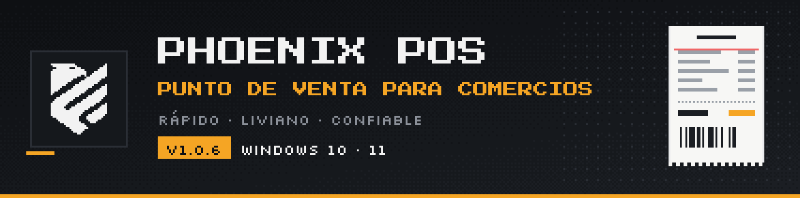
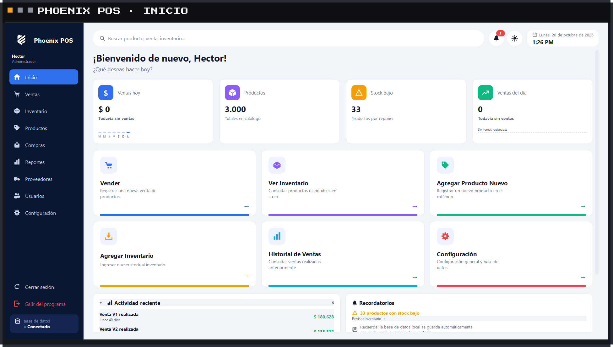
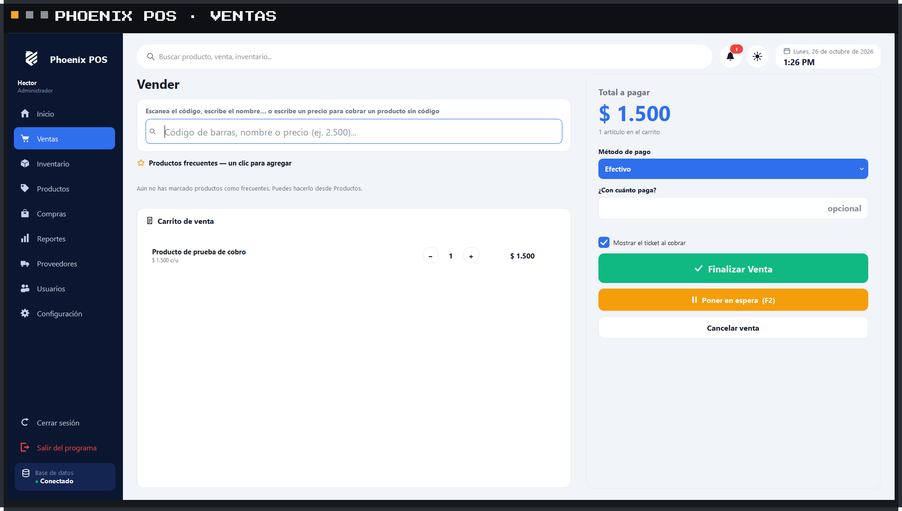
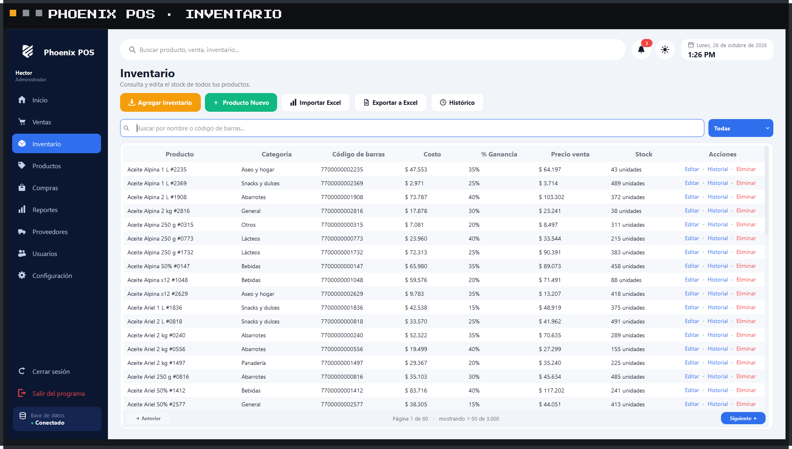
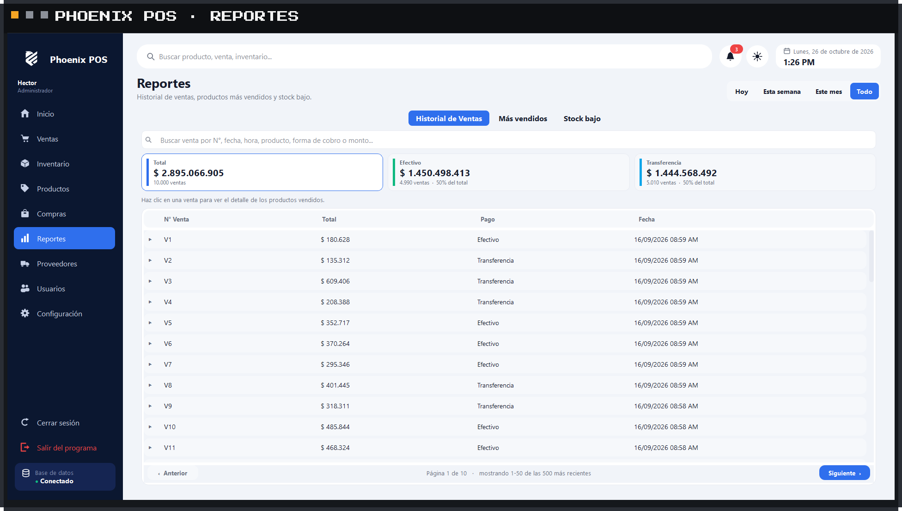

  

  Sistema de punto de venta para minimercados, tiendas y comercios. 
  Rápido, liviano y pensado para el día a día del negocio.

Phoenix POS es un sistema de punto de venta de escritorio que desarrollo y mantengo en **Phoenix TS**. Lo usan comercios reales: está hecho para cobrar rápido, controlar el stock sin complicaciones y funcionar bien incluso en computadoras de pocos recursos.

> El código fuente es privado. Este repositorio muestra el producto.

| | |
|---|---|
| **Ventas** | Lector de código de barras, búsqueda por nombre o precio, productos frecuentes, ventas en espera y ticket imprimible o en PDF. |
| **Formas de pago** | Efectivo, transferencia o pago mixto, con cálculo del vuelto. |
| **Inventario** | Productos con o sin código de barras, venta por unidad o por paquete, costo y porcentaje de ganancia, aviso de stock bajo. |
| **Compras y proveedores** | Registro de compras e historial de costos y precios. |
| **Reportes** | Ventas del día por hora, totales por forma de pago, productos más vendidos y exportación a Excel. |
| **Usuarios** | Administrador y vendedores con permisos separados y cierre de sesión por inactividad. |
| **Datos seguros** | Copias de seguridad automáticas, recuperación de una base dañada y sincronización con la nube. |
| **Interfaz** | Modo claro y oscuro, textos grandes y legibles, adaptada a distintas escalas de pantalla. |

- **C++17** y **Qt 6 (Widgets)** para una aplicación nativa, rápida y de bajo consumo.
- **SQLite** como base local, con migraciones versionadas e integridad verificada al arrancar.
- **Supabase (PostgreSQL)** para la sincronización en la nube, con conexión cifrada.
- Sistema de licencias por equipo e instalador **.msi**.
- Batería de pruebas automáticas: funcionales, de interfaz, de rendimiento con bases de 100.000 productos y 500.000 ventas, y de resistencia ante cortes de luz y disco lleno.

Software propietario. © 2026 Hector Melgarejo, Phoenix TS. Todos los derechos reservados.

